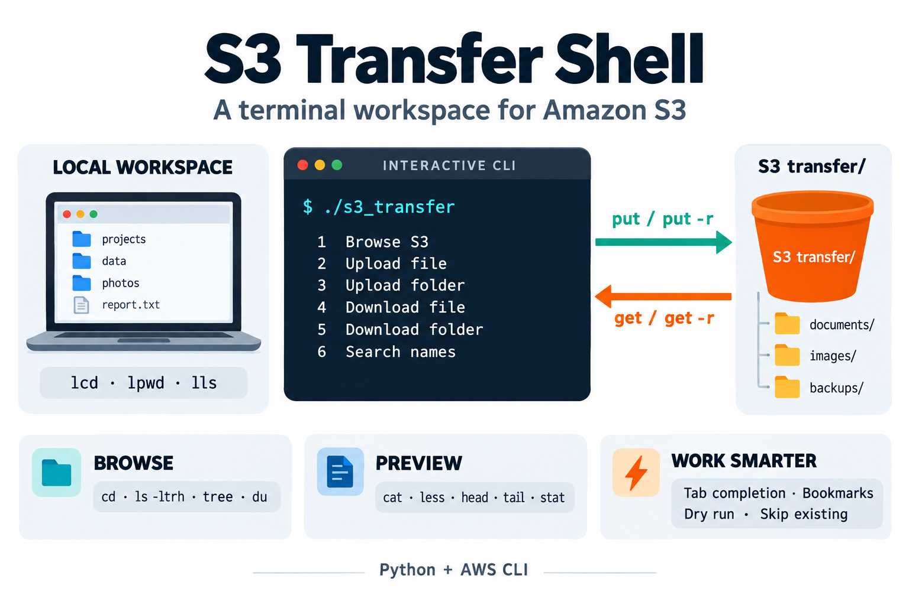

# S3 Transfer Shell

EC2 접속 없이 로컬 터미널에서 S3 파일을 탐색하고 읽거나 업로드·다운로드하는 도구입니다. 대상은 설정한 버킷의 `transfer/`이며, EC2 디스크에만 있는 파일은 조회하지 않습니다.



## 시작하기

Python 3.8 이상, AWS CLI, 사용할 버킷의 접근 권한이 필요합니다. `less`는 로컬 less 프로그램, Tab 자동완성은 Python readline을 사용합니다.

```bash
tar -xzf s3_transfer.tar.gz
cd s3_transfer
chmod +x s3_transfer
./s3_transfer
```

처음 실행하면 버킷 이름을 입력합니다. 다음은 가상의 예시입니다.

```text
S3 버킷 이름 (빈 입력: 취소): example-data-bucket
```

`s3://`나 `/transfer/` 없이 **버킷 이름만** 입력하세요. 설정은 자동 저장되며 다음 실행부터 다시 묻지 않습니다. 빈 입력·Ctrl-D·Ctrl-C는 설정을 취소합니다. 버킷의 존재·권한은 실제 S3 작업 시 확인하며, 설정 과정에서 버킷을 생성하지 않습니다.

실행 메뉴: **1 탐색 · 2 파일 업로드 · 3 디렉터리 업로드 · 4 파일 다운로드 · 5 디렉터리 다운로드 · 6 이름 검색 · 0 종료**.

## 버킷 변경

```bash
./s3_transfer --set-bucket another-data-bucket
./s3_transfer --show-config
./s3_transfer
```

`--set-bucket`은 프로그램이 사용할 버킷을 저장·변경하고 종료합니다. 기존 버킷 이름을 바꾸거나 파일을 이동하지 않습니다. 변경한 설정은 다음 실행부터 적용되므로 실행 중인 셸은 종료 후 다시 여세요. `--show-config`와 `--help`는 최초 설정 없이도 사용할 수 있습니다.

버킷 이름은 [일반 S3 버킷 명명 규칙](https://docs.aws.amazon.com/AmazonS3/latest/userguide/bucketnamingrules.html)에 맞춰 입력하세요. AWS 프로파일은 환경변수로 지정할 수 있습니다.

```bash
AWS_PROFILE=my-profile ./s3_transfer
```

## 탐색 예시

메뉴에서 `1`을 선택한 뒤 아래 명령을 입력합니다.

```text
pwd
ls -ltrh
cd results
cat report.txt | head -n 20
cat report.txt | less
lcd ~/Downloads
get report.txt
get -r results
put /path/to/sample.txt
put -r /path/to/results/
search sample
exit
```

| 명령 | 기능 |
| --- | --- |
| `pwd`, `lpwd` | 로컬·S3 위치 / 로컬 위치만 확인 |
| `cd 경로`, `cd ..`, `cd -` | S3 디렉터리 이동 / 상위 / 이전 위치 |
| `lcd 경로`, `lls -lh` | 로컬 기준 위치 변경 / 로컬 목록 |
| `ls [-altrh] [경로]` | 목록; 상세·시간순·역순·읽기 쉬운 크기 |
| `cat`, `less`, `head -n 20`, `tail -n 20` | 파일 전체 또는 앞·뒤 내용 읽기 |
| `get [-r] [-n] [--dry-run] 원본 [목적지]` | 파일·디렉터리 다운로드 |
| `put [-r] [-n] [--dry-run] 원본 [목적지]` | 파일·디렉터리 업로드 |
| `search 문자열` | 버킷의 `transfer/` 전체에서 이름 검색 |
| `tree [-L 깊이]`, `du -h`, `stat 파일` | 구조·전체 크기·객체 정보 |
| `bookmark add 이름`, `bookmark go 이름` | S3 상대 경로 북마크 저장·이동 |
| `bookmark list`, `bookmark rm 이름` | 북마크 조회·삭제 |
| `history`, `help`, `exit` | 세션 명령 기록·도움말·종료 |

- **Tab**: S3·로컬 경로 자동완성. 후보가 여러 개면 다시 Tab을 눌러 표시합니다. 메뉴의 로컬 경로 입력에서도 사용할 수 있습니다.
- **pwd**: 메뉴·검색어·경로·업로드 확인 등 모든 입력 단계에서 위치를 보고 같은 단계로 돌아옵니다. 메뉴에서 문자 그대로 `pwd`를 입력하려면 `\pwd`를 사용하세요.
- 셸에서 공백이 있는 경로는 따옴표로 감싸세요. 메뉴의 경로 입력은 따옴표 없이 입력합니다.
- `cat 파일 | less`, `cat 파일 | head [-n 줄수]`, `cat 파일 | tail [-n 줄수]`를 지원합니다. `less`는 `q`로 복귀합니다. 임의의 OS 명령·다단계 파이프는 지원하지 않습니다.
- `head`·`tail`은 UTF-8 텍스트를 부분 조회합니다. 아주 긴 줄이나 많은 줄을 요청하면 조회량이 커질 수 있습니다.

## 전송 규칙

- `get 파일`은 **현재 로컬 기준 위치**에 파일명으로 저장합니다. `lcd`로 위치를 변경할 수 있습니다.
- 목적지를 생략한 업로드는 상위 로컬 경로를 제외하고 **`transfer/파일명` 또는 `transfer/디렉터리명/`**에 저장합니다. 디렉터리 내부 구조는 유지합니다.
- 셸에서 업로드 목적지를 명시하면 해당 경로를 사용합니다. 상대 목적지는 현재 S3 위치 기준입니다.
- `-r`: 디렉터리 전송, `-n`: 기존 대상 건너뛰기, `--dry-run`: 전송 없이 미리보기. 기본 전송은 같은 이름의 파일을 덮어쓸 수 있으며 대상 파일을 삭제하는 동기화는 하지 않습니다.
- `ls`와 비재귀 `get`은 `*`, `?`, `[]` 패턴을 지원합니다.
- 업로드 원본이 없으면 같은 로컬 디렉터리에서 가장 비슷한 후보를 제안합니다. **`y`는 진행, `n`·Enter는 취소**합니다. 후보의 원본·목적지를 먼저 표시하며 `--dry-run`도 유지합니다.
- 없는 S3 대상은 유사 이름을 제안한 뒤 복귀합니다. 자동 추천은 최대 3초·3페이지로 제한하며 전체 검색은 `search`를 사용합니다.

## 메뉴 없이 실행

```bash
./s3_transfer --shell
./s3_transfer --pwd
./s3_transfer --upload-file /path/to/sample.txt
./s3_transfer --upload-dir /path/to/results/
./s3_transfer --download-file results/report.txt
./s3_transfer --download-dir results
./s3_transfer --search sample
```

직접 실행 옵션도 최초 실행 시 버킷을 설정합니다. `--download-file`·`--download-dir`은 로컬에 원격 상대 경로를 유지하며, 셸의 `get 파일` 기본 동작과 다릅니다.

## 구성·검증

최상위에는 실행 파일 `s3_transfer`와 `README.md`가 있습니다. 코드·테스트·호환 스크립트·그림은 `support/`에 있으므로 함께 유지하세요.

- 버킷 설정: `support/state/config.json`
- 북마크: `support/state/bookmarks.json` (상대 경로이며 버킷 변경 후에도 유지)
- 상태 저장 위치 변경: `S3_TRANSFER_STATE_DIR` 환경변수
- 설정·북마크·캐시·Git 관리 정보는 배포 압축본에 포함하지 않습니다. AWS 인증정보는 프로그램 설정에 저장하지 않습니다.
- GitHub 업로드 시 `README.md`는 저장소 최상위에, 그림은 `support/assets/s3-transfer-overview.png`에 두세요.

```bash
python3 -m unittest discover -s support -p 'test_*.py' -v
```

테스트는 모의 AWS와 임시 파일을 사용합니다. 인증 오류는 AWS 로그인·프로파일·권한을, Tab/less 오류는 readline·less 설치와 대화형 터미널 여부를 확인하세요. 잘못된 버킷 설정은 `--set-bucket 이름`으로 다시 저장할 수 있습니다.

## GitHub 등록 정보

**Repository:** `s3-transfer-shell`

**Description:** A menu-driven S3 file manager with an interactive shell, tab completion, previews, bookmarks, and recursive transfers.

설명 그림은 내장 imagegen으로 제작했습니다. [생성 프롬프트](support/assets/IMAGE_PROMPT.txt)를 포함합니다.
